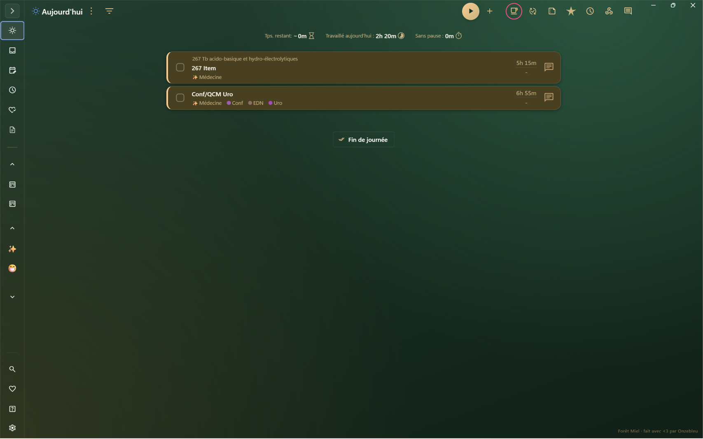

# 🌿🍯 Forêt Miel — a Super Productivity theme

A warm, nature-inspired dark theme for [Super Productivity](https://github.com/super-productivity/super-productivity), inspired by the deep greens and honey tones of Guadeloupe's tropical forest.

Evergreen backgrounds, bark-brown task cards with a honey accent, and a glowing jade highlight on your current task: easy on the eyes during long focus sessions.

## 🎨 Palette

| Name      | Hex       | Used for                    |
|-----------|-----------|-----------------------------|
| Canvas    | `#fcf8ec` | Text                        |
| Honey     | `#fdca89` | Task accent, buttons, icons |
| Amber     | `#cbb27a` | Muted text, separators      |
| Jade      | `#2a7f5e` | Header, current task glow   |
| Bark      | `#4a401d` | Task cards                  |
| Evergreen | `#132f20` | Background                  |

## 📦 Installation

1. Download `foret-miel.css` from this repository.
2. In Super Productivity, open **Settings → General → Appearance**.
3. Set **Dark Mode** to **Dark** for the best result.
4. Under **Theme**, click **Install theme** and choose `foret-miel.css`.
5. Select **Forêt Miel**, and you're done! No restart needed.

To update, simply install the new version of the CSS file again.

## ✨ Features

- Full set of theme tokens (surfaces, ink, states, separators, scrim)
- High-contrast task cards that stand out from the background
- Glowing highlight on the current task
- Works in both light and dark app modes

## 💬 Feedback

Found an element that doesn't look right? Feel free to open an issue with a screenshot.

---

Made with 🍯 by **Onzebleu**, from Guadeloupe 🇬🇵
